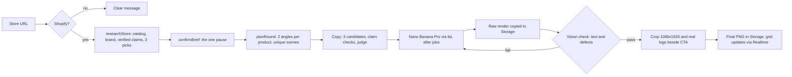

# Ploy AI Ads Manager: submission note

**Live:** https://ploy-ads.vercel.app (try `loopycases.com`). Code, plan and decision log: `PLAN.md`, `NOTES.md`.

## 60-second walkthrough
1. Paste a store URL. Non-Shopify sites get a clear message, and nothing is created.
2. The agent researches the store while a checklist streams progress: the catalog (228 products for Loopy), then the brand (logo, colors, voice, claims), then 3 picks.
3. A review card is the only pause. Here you can edit the brand kit, swap products, remove claims and pick the goal, and see the 2 angles each product will get. Then click **Generate 6 ads**.
4. The six 9:16 ads fill in live, in about 80 seconds for $0.90.
5. On each ad you can approve, reject, edit the words, leave feedback, regenerate or download. You can also steer from chat ("make the guarantee one warmer", "never use dark backgrounds"), and a version history shows what produced each version.

## Decisions where the brief was silent
- **Shopify only.** `products.json` gives me real prices, real discounts and product photos. Scraping other stores would mean guessing at all three.
- **Scrape, infer or ask.** Facts are scraped. Opinions (voice, audience) are inferred by the LLM. Taste is asked on the review card. Claims must appear word for word on the site, and promotions are rejected even when they do. My first runs let through "Buy 2 Get 1 FREE" and a ™ rewritten as ®, so I tightened the check.
- **One pause.** `confirmBrief` has no server handler, so nothing generates until the marketer clicks Generate. The card loads from the database, so the model can point at products but can't change a claim or price.
- **The pick mix.** Round 1 is one best seller, the newest drop and one in-season pick from the store's own collections, so the six ads have range. Holiday designs less than 14 days out are skipped because campaigns need time to ramp: five Halloween designs on Oct 27, each with a "Use anyway" button. Clearance stock never leads.
- **Model: Nano Banana Pro, chosen by a bake-off.** I ran 12 renders across 3 models and judged product fidelity as pass/fail first. Pro was the only model to pass on every output. Nano Banana 2.1 drew the product wrong in half its renders, and Seedream tied Pro on score but mostly pasted the photo.
- **Logo beside the CTA.** I asked the model to keep the top band empty for the logo. Its headline still crossed the line, and it painted solid bars to "keep it empty". So post-processing finds the real button and places the real logo next to it.
- **Anthropic directly, not the AI Gateway.** The gateway's free tier blocked every Claude model. All model calls go through `lib/llm.ts`, so switching back is a one-line change.

## How feedback changes the next generation
Every change creates a new version and keeps the old ones.
- **Ad feedback** applies to that ad only. The next version starts from the previous image, and notes accumulate oldest first. I measured warmth as average red minus blue. My first "warmer lighting" moved it from 55.8 to 58.5, which nobody would notice, so I changed the prompt to ask for a change visible at a glance. A follow-up then reached 94.5. On the live site, a single note took one ad from 35.0 to 46.8.
- **Copy edits** re-render from the previous image only. The average pixel change was 22.5 in the headline area and 3.2 everywhere else.
- **Campaign rules** apply to every later generation. After "Never use dark backgrounds", the regenerated ad's dark area fell from 22.8% to 10.9%.

## Known limitations
- **The CTA sometimes lands at the top.** The model occasionally puts the button under the headline. The logo stays in its corner, but the layout is off-brief.
- **A stale chat message.** "Six ads are rendering" stays in the chat after they finish. The grid is the source of truth.
- **No campaign list.** You can only get back to a campaign through its URL.
- **AI Elements deprecation.** AI Elements is being retired at the end of November 2026. The components are copied into the repo, so nothing breaks, but they should eventually move to shadcn.
- **Two failed renders cost $0.30.** An ad that fails twice then waits for a manual Retry.

## What I'd build next, and measure
- **Automatic layout checks:** re-render when the CTA isn't at the bottom. Measure the share of ads approved without edits, and the cost per approved ad.
- **A performance loop:** feed real installs and click-through from the ad network back into which angle and scene each product gets. Measure lift against a fixed round.
- **Multi-user auth.** The schema already has owner IDs.

## How I used Claude Code
I planned first and turned the plan into `PLAN.md`. Then I built in small, testable milestones (M0 to M7), stopping after each to review the output myself. Claude ran the experiments, but the calls were mine: the bake-off pass/fail rule, the 14-day holiday rule, copy quality over speed, and moving the logo instead of fighting the model. Testing against the real store caught bugs the unit tests didn't: a doubled headline, a page number inside a scene, and network errors that would have cost paid re-renders. Each became a fix with a test.
